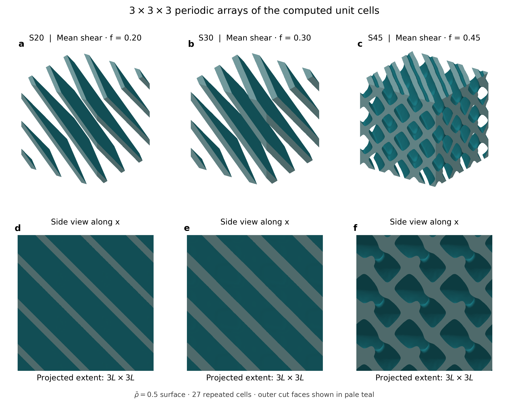
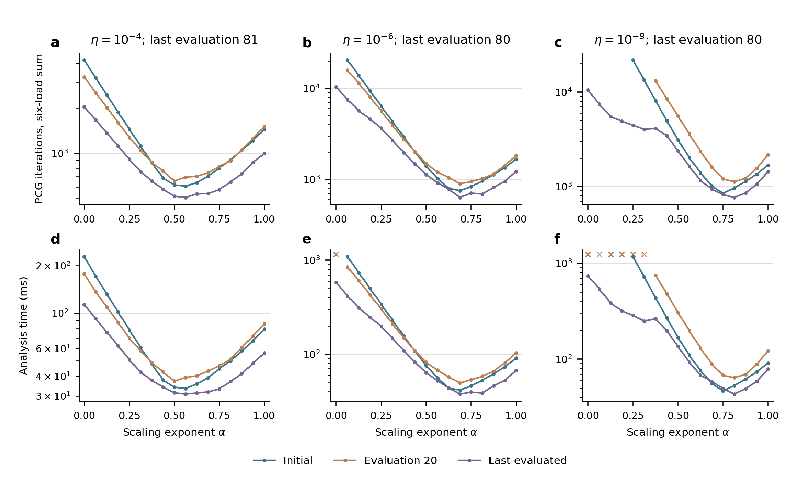

# Partial Green–Jacobi preconditioning

Research code for repeated elastic homogenization in density-based topology optimization of periodic cellular materials. It combines a discrete FFT reference inverse with partial symmetric diagonal scaling, and includes CUDA implementations of multi-load PCG, residual certification, sensitivity propagation and optimality-criteria updates.

[中文说明](README.zh-CN.md) · [Reproduction guide](docs/REPRODUCING.md) · [Data inventory](docs/DATA.md) · [Release v0.1.0](https://github.com/yufangjie1643/partial-green-jacobi/releases/tag/v0.1.0)



*Archived periodic shear designs from the accompanying research. These are computed density isosurfaces, not generated illustrations.*

## Method and scope

For positive scalar stiffness fields multiplying a fixed elastic tensor, the inverse preconditioner is

$$
M_\alpha^{-1}=P\,\widehat D^{-\alpha/2}\,G\,\widehat D^{-\alpha/2}\,P,
\qquad 0\leq\alpha\leq1.
$$

Here `P` removes translations, `G` is the discrete reference inverse and `D` is the stiffness diagonal, normalized by its geometric mean. `alpha=0` recovers Green and `alpha=1` recovers full Green–Jacobi. The exponent stays fixed during each PCG solve. Design updates can change the material, diagonal and selected exponent.

The implementation uses fully integrated periodic Q1/HEX8 elasticity, FP64 arithmetic, SIMP interpolation and positive weak material in pores. It supports serial loads with reused workspaces and parallel independent PCG recurrences. Both modes retain previous design-step displacements on the GPU.

Included comparisons: Green, GJ, fixed partial scaling, frozen ASG and Compact8; a calibrated three-entry table for weak-material ratios `1e-4`, `1e-6`, `1e-9`; and a controlled scaling ablation using native muTopOpt/muGrid PCG. The native ablation is our adapter, not an upstream muTopOpt feature.

## Start with the CPU reproduction

Python 3.12 is the tested version. No GPU is needed to regenerate the calibration table and the principal reported comparisons:

```bash
git clone --branch v0.1.0 https://github.com/yufangjie1643/partial-green-jacobi.git
cd partial-green-jacobi
python -m venv .venv
source .venv/bin/activate
python -m pip install -r requirements-cpu.txt
python scripts/reproduce_tables.py
python -m unittest discover -s tests -v
```

The script fits the three exponents from 172 development states and independently reconstructs the timing comparisons from paired test attempts. It does not run or time a GPU solver.

## Run a new design on a GPU

Install CUDA-enabled PyTorch and Ninja in the same environment; the measured configuration is in [ENVIRONMENT.md](docs/ENVIRONMENT.md). A local CUDA toolkit, compatible C++ compiler and `nvidia-smi` are required because kernels compile on first use.

```bash
python -m pip install -r requirements-gpu.txt
python examples/shear_design.py --n 16 --steps 10 --methods green gj 0.5 --load-modes serial parallel
```

This runs the same shear-design problem for all six method/schedule combinations, checks every true residual, and saves densities and per-load diagnostics under `outputs/shear/`. Choose a fresh `--output` directory for another run. The first invocation can take several minutes to compile; demonstration timings include first-use costs and are not the paper benchmark.

The original registered drivers in `exp/` retain their dated names to preserve traceability. Use the [reproduction guide](docs/REPRODUCING.md) for full 180-evaluation workflows, frozen-state timing and the optional external solver comparison.

## Data and fixed versions

Small source tables, parameter freezes and the ASG comparator weights are in Git. Original density fields, warm starts and detailed replay records are separate release assets, each with a SHA-256 checksum and a per-file manifest. Download only the needed study:

```bash
python scripts/fetch_data.py --list
python scripts/fetch_data.py independent-test-data
```

The manuscript version is **v0.1.0**. The default branch may subsequently evolve; cite the release and commit when reporting a reproduction. This release has a GitHub version URL; a Zenodo DOI has not been assigned.

## Interpretation of results

The archived Study I baseline gives a 52.3% reduction in the same-budget workflow time against GJ with fixed `alpha=0.5`. Its two primary designs exhausted the 180-evaluation budget, so this is not a comparison of times to a common optimization convergence tolerance. The independent high-contrast replay gives 40.3% lower case-equal mean analysis time than GJ and 5.04% lower than Compact8, with an 8.86% worst-case regression against Compact8. These are archived measurements, not universal speed guarantees. Full-workflow and frozen-state results have different timing boundaries.



## Layout

| Location | Contents |
|---|---|
| `examples/` | Fresh-design and single-state entry points |
| `solver/` | Archived operator, discrete reference and PCG source |
| `exp/` | Study adapters, CUDA kernels and registered experiment drivers |
| `data/` | Small source tables, freezes and release-asset inventory |
| `scripts/` | CPU reconstruction and checksum-verified data download |
| `validation/` | Publication-checkout verification results |
| `provenance/` | Source export hashes and portability changes |
| `licenses/` | Upstream license notices |

## License and citation

Project source, generated numerical data and original figures are released under the [MIT License](LICENSE), subject to [third-party notices](docs/THIRD_PARTY.md). muGrid and CUDA are external dependencies with their own terms. Vendor binaries, CUDA headers, journal PDFs, private manuscript drafts and workstation configuration are excluded.

Use [CITATION.cff](CITATION.cff) to cite this software release. The associated manuscript is a working paper; no journal acceptance or paper DOI is implied.
