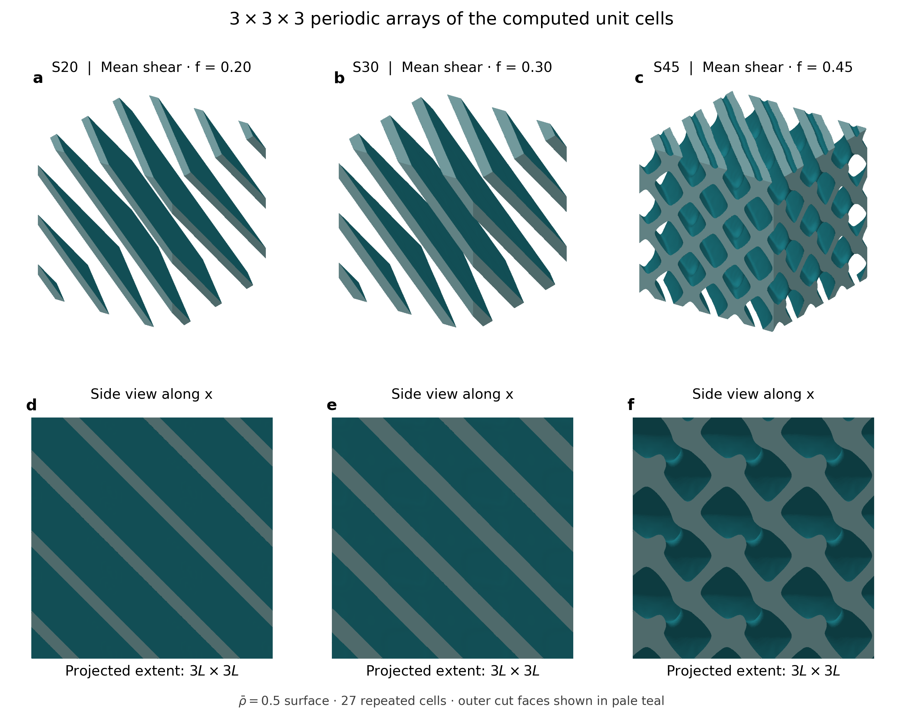

# 部分 Green–Jacobi 预条件：论文复现代码

本仓库提供周期胞状材料密度法拓扑优化中的弹性分析与预条件对比代码。核心改进是以指数控制 FFT 参考逆算子两侧的对称对角缩放：指数为 0 对应 Green，指数为 1 对应 GJ，中间值对应部分缩放。指数在一次 PCG 求解期间保持固定。

代码保留周期零均值投影、真实残差核验、GPU 上的灵敏度链式处理和 OC 更新，支持载荷串行与并行，以及相邻设计步位移热启动。实体／孔隙采用正弱材料比的 SIMP 插值。



## 最快的核验入口

```bash
python -m pip install -r requirements-cpu.txt
python scripts/reproduce_tables.py
python -m unittest discover -s tests -v
```

这一步使用 CPU，重新从 172 个开发状态的扫描数据拟合三档指数，并从独立测试的逐次记录重新计算论文的主要比较值。输出包括相对 GJ 的平均收益以及相对 Compact8 的最差案例退化；失败尝试保留在数据中。

## 运行新的小算例

在 CUDA、兼容编译器及 CUDA 版 PyTorch 安装完成后：

```bash
python -m pip install -r requirements-gpu.txt
python examples/shear_design.py --n 16 --steps 10 --methods green gj 0.5 --load-modes serial parallel
```

输出包含材料密度、每个载荷的迭代数和真实残差。首次运行需要编译 CUDA 扩展；示例计时包含首次使用开销，正式性能比较应使用注册的实验驱动。环境信息与具体命令见 [复现指南](docs/REPRODUCING.md)。

## 开源范围与版本

采用“源码仓库＋版本化数据附件”的形式：小型表格、冻结参数和基线模型随 Git 保存，原始密度场、热启动位移和详细回放记录通过 [v0.1.0 Release](https://github.com/yufangjie1643/partial-green-jacobi/releases/tag/v0.1.0) 下载。下载器逐项检查 SHA-256，数据包内另含逐文件清单。

```bash
python scripts/fetch_data.py --list
python scripts/fetch_data.py independent-test-data
```

论文使用版本固定为 **v0.1.0**。当前没有分配 Zenodo DOI。参考形式来自 Zotero 中的 homo3d、SCTOP、GPU 拓扑优化与 GJ 文献，具体核对见 [开源形式调研](docs/OPEN_SOURCE_PRECEDENTS.zh-CN.md)。

Study I 的完整流程收益与 Study II 的冻结状态分析收益应分别理解：前者比较同样的优化预算，主要两个设计未达到额外的优化收敛条件；后者评价求解器在同一材料场上的分析成本。三档表的平均收益不代表它在所有设计中优于 Compact8，也不能推导为已证明跨场景完整优化加速。

[英文完整说明](README.md) · [数据清单](docs/DATA.md) · [第三方声明](docs/THIRD_PARTY.md) · [MIT 许可证](LICENSE)
